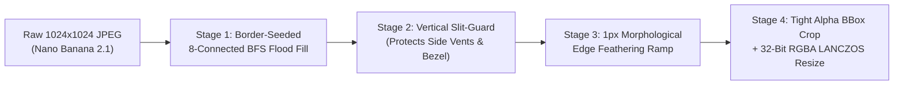

# Nano Banana 2.1 Asset Engineering & BFS Alpha-Matting Pipeline

Parent Hub: [[README|Circuit Sandbox 4.0 Master Architecture Hub (MOC)]]  
Related Docs: [[UI_UX_ANTISLOP_AND_MOBILE_ENGINE]], [[HARDWARE_COMPONENTS_AND_PROTECTION]], [[DEVLOG_ANTISLOP_MODAL_AND_ASSET_OVERHAUL]]

---

## 1. Why Code-Generated SVG Icons Were Replaced (`R-04` & `R-23`)

Prior to the Anti-Slop overhaul, several laboratory components (`switch`, `voltmeter`, `ammeter`, `ground`, `distribution-panel`, and the app emblem) relied on code-generated `<svg>` glyphs (`ComponentGlyph.tsx`, `PresetThumbnail.tsx`) with multi-color neon strokes (`#38bdf8`, `#34d399`, `#f59e0b`, `#ef4444`).

To achieve tactile hardware authenticity across [[HARDWARE_COMPONENTS_AND_PROTECTION|all SNI/IEC lab instruments]], every component now uses a physical hardware illustration generated via **Google Flow (Nano Banana 2.1)** and processed through a deterministic computer-vision alpha-matting pipeline.

---

## 2. Prompt Engineering Formula for Nano Banana 2.1

Through iterative calibration (comparing grainy 3D studio renders and overly flat 2D vectors against the benchmark `power-supply.png` and `solar-panel.png` assets), we established the canonical **Circuit Sandbox Hardware Prompt Formula**:

1. **Camera & Medium**:
   - `"A straight-on front view semi-realistic 2D vector illustration of a modern laboratory [instrument name]..."`
2. **Explicit Anatomical Layout (Bullet Points)**:
   - Top-to-bottom structural specification (e.g., recessed dark glass LCD screen with diagonal reflection, horizontal accent groove, knurled copper/brass binding posts at the bottom edge).
3. **Surface & Shading Constraints**:
   - `"Sleek dark grey metallic casing with clean rounded edges. Smooth gradients and subtle shadows. NO thick outlines. NO drop shadows."`
4. **Strict Zero-Text Guardrail**:
   - `"Absolutely NO text, NO letters, NO digital numbers, NO plus or minus symbols. Just the physical box with indented cutouts..."` (prevents AI text artifacts and allows live React monospace telemetry overlays in `VoltmeterNode.tsx` and `AmmeterNode.tsx`).
5. **Alpha-Keying Isolation Background**:
   - `"Isolated on a pure solid black background (#000000). High-quality, modern tech aesthetic."`

---

## 3. $O(W \times H)$ Exterior BFS Flood-Fill & Slit-Guard Alpha Matting

Because laboratory instruments contain **dark interior features** (such as recessed `#050a0e` LCD screens, dark charcoal casings, and side ventilation slots), a naive global color-threshold key (`L < threshold`) would punch transparent holes inside the meters and side vents.

Our asset processor (`scripts/process_new_assets.py`) implements a 4-stage $O(W \times H)$ computer-vision pipeline:

### Stage 1 & 2: Border-Seeded BFS with Vertical Slit-Guard
- Seeds the Breadth-First Search queue strictly from the 4 outer image borders (`x = 0`, `x = W-1`, `y = 0`, `y = H-1`) where pixel luminance $L = \max(R, G, B) \le 6$.
- **Vertical Slit-Guard**: When the flood fill attempts to step horizontally into a narrow dark side vent (such as the cooling slots on `ammeter.png`), it checks vertical neighbor luminance at $y \pm 6\,\text{px}$. If both `above_bright` ($L > 18$) and `below_bright` ($L > 18$) are true, the pixel is classified as an **interior chassis slot** and the flood fill is blocked from entering.

### Stage 3: Anti-Halo Boundary Feathering & Color Decontamination
- Pixels within a $2\,\text{px}$ Manhattan radius of the exterior background mask undergo a linear alpha ramp:
  $$\alpha = \text{clamp}\left(\frac{L - 3}{42 - 3},\; 0,\; 1\right)$$
- Semi-transparent edge pixels ($0 < \alpha < 0.85$) have their RGB channels divided by $\max(0.35, \alpha)$ to un-premultiply the black background halo.

### Stage 4: 32-Bit RGBA Output vs. 8-Bit Octree Quantization
- **Discovery**: Applying 256-color `FASTOCTREE` palette quantization caused visible concentric color banding on the warm tungsten filament glow of `logo-circuit-sandbox.png`.
- **Solution**: Retaining full 32-bit RGBA with `LANCZOS` downsampling to target canvas dimensions (`256px`–`380px`) and `optimize=True` lossless PNG compression completely eliminates glow banding while keeping every asset between **8 KB and 90 KB**.

---

## 4. Catalog of Processed Hardware Assets

| Asset File | Dimensions | Size | Target Components |
| :--- | :--- | :--- | :--- |
| `public/assets/logo-circuit-sandbox.png` | `256×256` | `84.9 KB` | `Header.tsx`, `WelcomeModal.tsx`, `MobileHubModal.tsx` |
| `public/favicon.png` | `64×64` | `8.3 KB` | `index.html` (`<link rel="icon">`) |
| `public/assets/switch-knife.png` | `380×287` | `65.2 KB` | `SwitchNode.tsx`, `PaletteTile.tsx`, `PresetThumbnail.tsx` |
| `public/assets/voltmeter.png` | `301×360` | `72.6 KB` | `VoltmeterNode.tsx` (with live `V` LCD overlay) |
| `public/assets/ammeter.png` | `329×360` | `90.6 KB` | `AmmeterNode.tsx` (with emerald bezel & live `A`/`mA` LCD overlay) |
| `public/assets/ground-terminal.png` | `262×340` | `62.8 KB` | `GroundNode.tsx` (`0.00 V` reference node) |
| `public/assets/distribution-panel.png` | `360×360` | `Existing` | Restored in `usePaletteBrowser.ts` for Indoor Lab mode |

---

## 5. Connected Knowledge Nodes

- [[README]]
- [[UI_UX_ANTISLOP_AND_MOBILE_ENGINE]]
- [[DEVLOG_ANTISLOP_MODAL_AND_ASSET_OVERHAUL]]
- [[HARDWARE_COMPONENTS_AND_PROTECTION]]
- [[TESTING_AND_VERIFICATION_MATRIX]]
