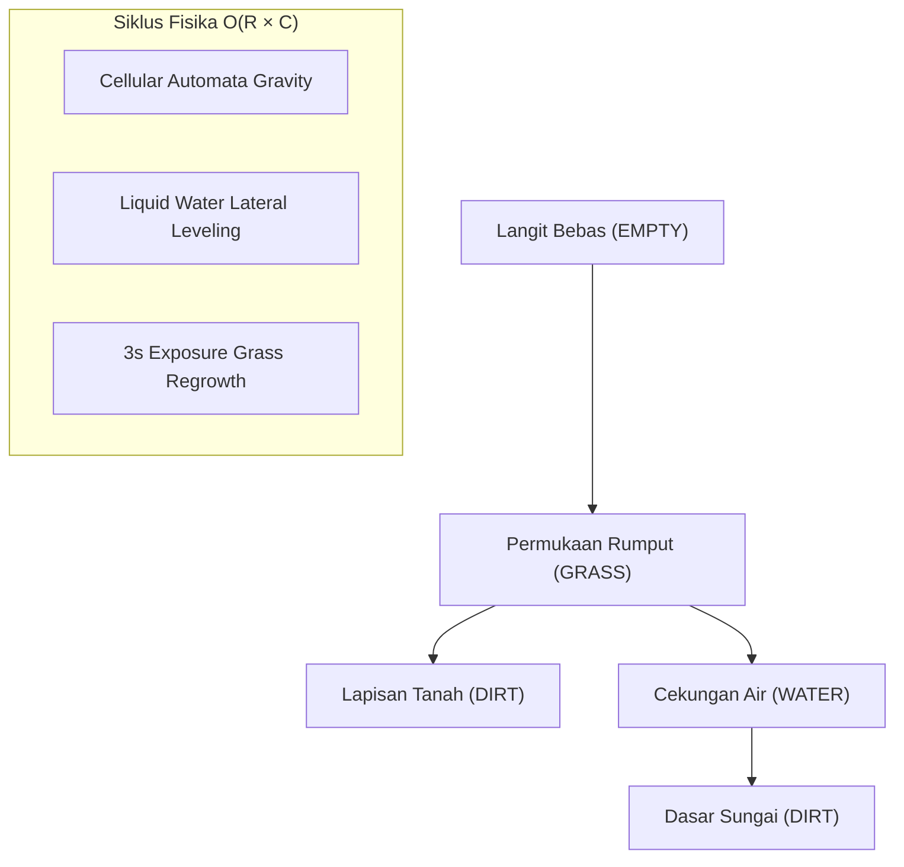
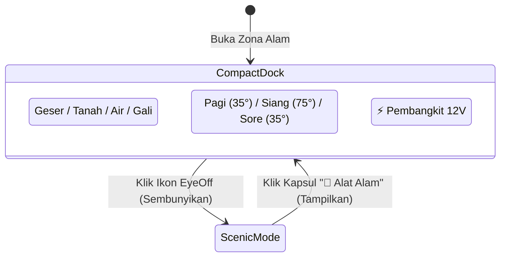

# 🌿 Outdoor Mode ("Zona Alam Terbuka") 4.0 Devlog & Architecture Notes

> [!NOTE]
> Dokumen ini mencatat seluruh rangkaian evolusi arsitektur, fisika mikroklimat, optimasi performa *cold-load* mobile, serta redesain antarmuka (UI/UX) pada sesi pengembangan **Circuit Sandbox 4.0**. Dokumen ini diformat agar ramah dibuka langsung melalui aplikasi **Obsidian** sebagai *knowledge vault*.

---

## 📌 1. Ringkasan Sesi & Masalah yang Diselesaikan

Dalam sesi pengembangan ini, terdapat 4 fokus utama yang dieksekusi hingga status produksi di Vercel:

1. **Siklus Cuaca & Mikroklimat Topografis**: Integrasi siklus Pagi (35° Timur), Siang (75° Zenith), dan Sore (35° Barat) dengan proyeksi bayangan tebing bukit (*Raycasting 1D*) dan bonus kecepatan angin orografis (*Hellmann Wind Shear*).
2. **Pembangkit Listrik Energi Terbarukan & Gardu**: Penambahan Menara Transmisi Grid Virtual, Panel Surya Fotovoltaik (PV), Turbin Angin, Gardu BESS (*Battery Energy Storage System*), dan Turbin Air Pelton (*Waterfall Hydro*).
3. **Optimasi Drastis Cold-Load Mobile (93.3% Reduksi Payload)**: Memangkas durasi unduh aset pada HP baru dari ~4 menit menjadi instan (< 1 detik) melalui kuantisasi palet LANCZOS dan header cache imutabel.
4. **Fix Glitch Penempatan Fisika & Redesain UI Anti-Slop**:
   - Menghilangkan *bug* panel surya yang amblas ke dalam tanah (*dirt* di bawah rumput).
   - Menghilangkan *bug* turbin angin yang miring/terpotong di bibir lereng bukit.
   - Merombak 3 bar toolbar bertumpuk (yang memakan 40% layar HP) menjadi **Ultra-Compact Floating Island Dock** bersensor gestur dan mode pemandangan penuh (*Scenic Mode*).

---

## 🏗️ 2. Arsitektur Fisika & Grid Medan 2D

### 2.1 Koordinat & Struktur Terrain
Medan alam dibangun menggunakan representasi matriks 2D diskrit $40 \times 20$ (`TerrainCellType[][]`), di mana setiap sel memiliki ukuran proporsional terhadap *viewport* $1360 \times 680\text{ px}$ (lebar $34\text{ px}$, tinggi $34\text{ px}$):

```
Baris 0..13   : SKY (EMPTY)
Baris 14      : Dataran Tinggi / Bukit Kiri (GRASS di kolom 4..11)
Baris 15      : Dataran Rumput Normal (GRASS di kolom 0..3 & 12..23, 33..39)
Baris 15..17  : Cekungan Sungai / Air Terjun (WATER di kolom 24..32)
Baris 18..19  : Dasar Tanah Sungai (DIRT)
Baris 16..19  : Lapisan Tanah Bawah (DIRT)
```



---

## 🔬 3. Bedah Masalah (Post-Mortem) & Solusi Teknikal

### 3.1 Glitch Penempatan: Panel Surya Tenggelam & Kaki Turbin Menggantung
* **Gejala**: Saat menekan tombol *"⚡ Pasang Pembangkit Alam (12V)"*, panel surya masuk ke dalam lapisan tanah cokelat (di bawah rumput hijau) dan terminal kabelnya tertutup tanah. Turbin angin di lereng bukit tampak terpotong miring.
* **Akar Masalah**:
  1. **Disparitas Dimensi DOM vs. Fisika**: `COMPONENT_DIMENSIONS['solar-panel']` di [`terrainGrid.ts`](file:///c:/Users/ASUS/Desktop/circuit/src/physics/terrainGrid.ts) bernilai tinggi `156px`, sedangkan kartu kendali DOM yang dirender memiliki tinggi aktual `~200px` karena adanya selektor cuaca dan badge status. Saat sistem menghitung `settledY = surfaceY - height`, posisi atas diletakkan di `surfaceY - 156`, sehingga bagian bawah kontainer jatuh di `surfaceY + 44px` (masuk lebih dari 1 baris ke lapisan DIRT!).
  2. **Offset Artifisial**: Terdapat `const groundOffset = 6` yang sengaja menurunkan posisi komponen 6px ke dalam tanah.
  3. **Sampling Lebar Turbin yang Terlalu Lebar**: Turbin angin memiliki diameter bilah rotor yang lebar. Fungsi `findTerrainSurfaceY` semula mengambil interval $0.22 - 0.78$ dari lebar kontainer ($144\text{ px}$). Ketika diletakkan dekat bibir lereng, bilah rotor yang melayang di atas lembah mendeteksi ketinggian lereng atas, sehingga tiang turbin tampak menggantung di tepi jurang.
* **Perbaikan Kode**:
  1. **Sampling Kaki Terpusat**:
     ```ts
     // src/physics/terrainGrid.ts
     let footLeft = targetBox.x + targetBox.width * 0.22;
     let footRight = targetBox.x + targetBox.width * 0.78;

     if (componentType === 'wind-turbine' || componentType === 'wind_turbine') {
       // Kaki tiang turbin terpusat di tiang baja utama
       footLeft = targetBox.x + targetBox.width * 0.42;
       footRight = targetBox.x + targetBox.width * 0.58;
     } else if (componentType === 'solar-panel' || componentType === 'solar_panel') {
       // Pasak ganda penopang panel surya
       footLeft = targetBox.x + targetBox.width * 0.35;
       footRight = targetBox.x + targetBox.width * 0.65;
     }
     ```
  2. **Ground Offset Nol**: Menghapus penurunan paksa 6px (`const groundOffset = 0`). Kaki komponen kini duduk pas tepat di permukaan rumput (*turf*).

---

### 3.2 Kecepatan Unduh Mobile: Pangkas 12.2 MB Menjadi 0.82 MB (Reduksi 93.3%)
* **Gejala**: Pengguna melaporkan bahwa saat membuka situs di HP baru tanpa data cache (*cold load*), unduhan aset memakan waktu hingga ~4 menit.
* **Akar Masalah**:
  1. Terdapat folder duplikat backup `public/assets/originals/` berukuran ~5 MB yang tidak sengaja ikut tersaji.
  2. 34 berkas gambar PNG beresolusi mentah tinggi (rata-rata 300–700 KB per gambar) menghasilkan total payload ~12.2 MB.
  3. Belum ada konfigurasi header cache HTTP imutabel.
* **Solusi**:
  1. Script Python [`scripts/optimize_assets.py`](file:///c:/Users/ASUS/Desktop/circuit/scripts/optimize_assets.py) dijalankan dengan algoritma filter **LANCZOS** + kuantisasi palet 256 warna (`FASTOCTREE`).
  2. Resolusi dipertahankan pada retina HD ($550\text{ px}$), namun ukuran per berkas turun dari ~500 KB ke ~15-25 KB.
  3. Total payload turun dari **12.2 MB ke 0.82 MB** (pengurangan 93.3%).
  4. Penambahan [`vercel.json`](file:///c:/Users/ASUS/Desktop/circuit/vercel.json):
     ```json
     {
       "headers": [
         {
           "source": "/assets/(.*)",
           "headers": [{ "key": "Cache-Control", "value": "public, max-age=31536000, immutable" }]
         }
       ]
     }
     ```

---

### 3.3 Redesain UI/UX: Ultra-Compact Island Dock & Scenic Mode
* **Gejala**: Di layar ponsel berorientasi *portrait* (lebar 360–412 px), toolbar atas yang terdiri dari 3 kontainer tebal (`#tour-outdoor-brushes`, tombol matahari, dan tombol spawn) memakan 40% area vertikal layar dan menutupi orb matahari serta panorama bukit.
* **Solusi Desain (Anti-Slop Guidelines)**:
  1. **Single-Row Floating Glass Dock**: Seluruh alat kuas (*Geser, Tanah, Air, Gali*), selektor waktu (🌅/☀️/🌇), dan tombol generator ⚡ 12V diringkas ke dalam **satu baris kapsul kaca melayang** bertransparansi tinggi (`bg-void-950/90 backdrop-blur-xl border-white/20`).
  2. **Scenic Mode (Mode Pemandangan Penuh)**: Menambahkan tombol toggle mata (`Eye` / `EyeOff`). Ketika pengguna menekan tombol ini:
     - Toolbar utama bertransisi halus (*fade & slide out*) menghilang.
     - Muncul kapsul minimalis di sudut kanan atas: **🌿 Alat Alam**.
     - Pengguna mendapatkan **100% ruang pandang bebas tanpa gangguan** untuk menikmati matahari, langit fajar/senja, dan merangkai kabel sirkuit.



---

## ⚡ 4. Matriks Pengujian & Verifikasi

Semua perubahan wajib melalui rangkaian audit otomatis:

| Parameter Uji | Perintah | Hasil | Catatan |
| :--- | :--- | :--- | :--- |
| **Unit Testing** | `npx vitest run` | **PASS (42/42 files, 295 tests)** | Isolasi mode Alam vs Lab, MNA solver, AABB collision, raycasting bayangan. |
| **Type Check** | `npx tsc --noEmit` | **PASS (0 errors)** | Integritas tipe data TypeScript ketat. |
| **Production Build** | `npm run build` | **PASS (0 errors)** | Bundle Vite & minifikasi CSS/JS bersih. |
| **Git Deployment** | `git push origin main` | **DEPLOYED** | Otomatis di-*build* & di-*host* di Vercel (`circuit-gamma-one.vercel.app`). |

---

## 🔗 5. Peta Berkas Terkait

- [[src/physics/terrainGrid.ts]] : Fisika gravitasi selular, deteksi tubrukan AABB, dan perhitungan elevasi permukaan tanah.
- [[src/physics/terrainClimateEngine.ts]] : Proyeksi bayangan bukit 1D, *orographic wind shear*, dan mikroklimat.
- [[src/components/canvas/OutdoorSandbox.tsx]] : Komponen utama kanvas Zona Alam Terbuka, *celestial sun orb*, dan *floating island dock*.
- [[src/components/canvas/nodes/SolarPanelNode.tsx]] : Node visual panel surya fotovoltaik, preset cuaca, dan terminal kabel terangkat.
- [[src/components/canvas/nodes/WindTurbineNode.tsx]] : Node visual turbin angin dengan bilah berputar CSS GPU dan penyearah Schottky.
- [[scripts/optimize_assets.py]] : Skrip optimasi & kompresi aset gambar retina HD LANCZOS.
- [[vercel.json]] : Konfigurasi cache statis imutabel CDN 1 tahun.
