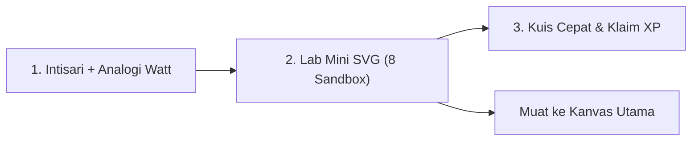

# Mascot Engineering (`Watt`), Duolingo-Style Academy & Simplified Missions

Parent Hub: [[README|Circuit Sandbox 4.0 Master Architecture Hub (MOC)]]  
Related Notes: [[PEDAGOGY_ACADEMY_AND_EXPLAINABLE_TUTOR]], [[ASSET_PIPELINE_NANO_BANANA_AND_ALPHA_MATTING]], [[UI_UX_ANTISLOP_AND_MOBILE_ENGINE]]

---

## 1. CFL Mascot (`Watt`) Asset & Component System

To remove generic AI-template sterility and give learners playful contextual feedback, an 8-expression **Watt** compact-fluorescent mascot suite was extracted into `public/assets/mascot/` using [`scripts/process_mascot_sheet.py`](../scripts/process_mascot_sheet.py):

- **Alpha Extraction**: Exterior 4-connected BFS flood-fill plus interior enclosed cream hole cleanup (`mark_enclosed_cream_holes`) separating arms/legs cleanly without eroding specular highlights (`love` eyes, highlights).
- **8 Expression Sprites (`240x240` RGBA)**: `celebrate`, `proud`, `bored`, `confused`, `love`, `dance`, `angry`, `sad`.
- **Reusable Component (`src/components/ui/common/MascotAvatar.tsx`)**: Exports `MascotAvatar`, `resolveMascotAssetSrc`, and `MascotCoachBubble` for DRY deployment across Academy, Missions, Outdoor Grid popup, and Short-Circuit `0V` alerts.

---

## 2. Rebalanced 14-Lesson, 2,500 XP Curriculum & 8 SVG Micro-Labs

Previously, `ACADEMY_LESSONS` contained only 7 lessons totaling `560 XP`, making `Level 6` (`2,000 XP`) and upper badges (`safety_officer` at 10 lessons, `renewable_pioneer` at 14 lessons) mathematically unreachable.

- **14 Balanced Micro-Lessons (`src/academy/academyCatalog.ts`)**: Sums to **2,500 XP** across Levels 1-6 while keeping all 7 legacy lesson IDs intact (`l1_ohms_law` .. `l6_modified_nodal_analysis`).
- **8 Playable SVG Micro-Labs (`src/components/ui/academy/demos/`)**: Built over shared DRY [`MiniLabFrame.tsx`](../src/components/ui/academy/demos/MiniLabFrame.tsx) with live mini-challenges (`ohms_law`, `joule_power`, `kcl_junction`, `voltage_divider`, `led_polarity`, `short_circuit_mcb`, `sutet_loss`, `mna_matrix`).
- **3-Step Duolingo Flow (`AcademyModal.tsx`)**: Replaces tall stacked walls of theory text and the bulky 4-card header strip with 1 slim sticky XP/streak bar, Watt analogies, optional collapsible formula drawers, and interactive quizzes.

---

## 3. Simplified Missions Modal (`MissionModal.tsx`)

- Shares `LabModalHeader` and reactive `MascotCoachBubble` (`angry` on active short circuit, `celebrate` on 100%, `proud` >= 50%).
- Adds crisp compact vector schematics per mission via [`MissionTopologyPreview.tsx`](../src/components/ui/missions/MissionTopologyPreview.tsx) and hides verbose multi-line instructions/hints inside a 1-tap toggle drawer.

---

## 4. Connected Knowledge Nodes

- [[README]]
- [[PEDAGOGY_ACADEMY_AND_EXPLAINABLE_TUTOR]]
- [[OUTDOOR_TO_LAB_CHARGING_BRIDGE]]
- [[UI_UX_ANTISLOP_AND_MOBILE_ENGINE]]
- [[TESTING_AND_VERIFICATION_MATRIX]]
