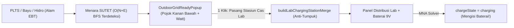

# Outdoor Power Plant + SUTET to Lab Battery Charging Bridge

Parent Hub: [[README|Circuit Sandbox 4.0 Master Architecture Hub (MOC)]]  
Related Notes: [[ARCHITECTURE_OUTDOOR_AND_LAB_QUARANTINE]], [[HARDWARE_TRANSMISSION_AND_TRAFO_SUTET]], [[PHYSICS_MNA_SOLVER_AND_TRANSMISSION_GRID]]

---

## 1. Solving the User "So What?" Question

Previously, users who built an outdoor solar/wind/hydro power plant wired to a **SUTET Transmission Tower** in *Alam EBT* had no intuitive cue answering two essential questions:
1. *"What is the point of setting up outdoor power plants + SUTET?"*
2. *"After electricity is routed to the Lab, what does it actually do?"*

The system now surfaces the complete physical feedback loop **Outdoor EBT -> SUTET Export -> Lab Panel -> Battery Recharge** whenever a valid generator-to-SUTET network is detected.

---

## 2. Graph Evaluation & Non-Destructive Lab Placement

- **Readiness Evaluator (`src/physics/outdoorGridReadinessAdvisor.ts`)**: `evaluateOutdoorGridReadiness` builds an adjacency list in **$O(N + E)$** and runs Breadth-First Search from `transmission-tower` nodes to detect active outdoor generators (`solar-panel`, `wind-turbine`, `hydro-turbine`, `bess-substation`) delivering live power.
- **Floating Advisor UI (`src/components/ui/diagnostics/OutdoorGridReadyPopup.tsx`)**: Appears cleanly at bottom-right above mobile scrub controls with `Watt` coaching, an expandable 3-step visual explainer modal, and a 1-tap **"Pasang Stasiun Cas di Lab"** button.
- **Safe Non-Destructive Station Merge (`src/utils/labChargingStationUtils.ts`)**: `computeSafeLabChargerOrigin` computes existing Lab node bounding boxes so clicking the CTA switches to `worldMode = 'lab'` and appends a wired `Panel Distribusi Lab` (`transmission-tower`) -> depleted `9V` rechargeable battery (`battery9v`) station without wiping student circuits.
- **Store Action (`deployOutdoorChargingStationInLab`)**: Dispatched in `useCircuitStore`, appends nodes/edges, sets world mode to `'lab'`, and triggers immediate MNA recalculation so `chargeState === 'charging'`.

---

## 3. Connected Knowledge Nodes

- [[README]]
- [[ARCHITECTURE_OUTDOOR_AND_LAB_QUARANTINE]]
- [[HARDWARE_TRANSMISSION_AND_TRAFO_SUTET]]
- [[MASCOT_AND_DUOLINGO_ACADEMY_DESIGN]]
- [[TESTING_AND_VERIFICATION_MATRIX]]
