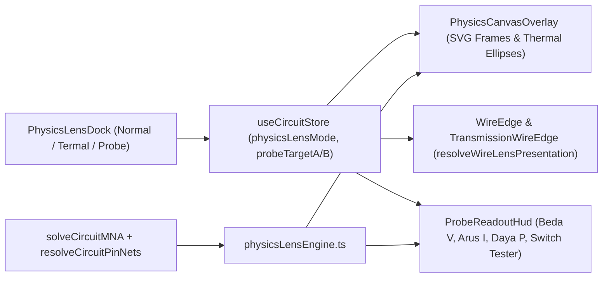

# Physics X-Ray Lens (Thermal & Probe), Mobile Zoom Lock & Scientific Audit Fixes

Parent Hub: [[README|Circuit Sandbox 4.0 Master Architecture Hub (MOC)]]  
Source Modules: `src/physics/physicsLensEngine.ts`, `src/physics/mnaSolver.ts`, `src/physics/oscilloscopeTelemetry.ts`, `src/components/canvas/PhysicsCanvasOverlay.tsx`, `src/components/ui/lens/PhysicsLensDock.tsx`, `src/components/ui/lens/ProbeReadoutHud.tsx`, `src/hooks/usePhysicsLensCanvasHandlers.ts`

---

## 1. Dual-Mode Physics X-Ray Lens (`Normal | Termal | Probe`)

Commits `449b526`, `79593d5`, and `5da484e` introduce a non-intrusive dual visualization overlay synced 1:1 with ReactFlow viewport pan/zoom via `useViewport()` across both **Lab Rangkaian** (`CircuitCanvas.tsx`) and **Alam EBT** (`OutdoorSandbox.tsx`).

### A. FLIR Thermal Camera Mode (`Termal`)
- Computes Joule dissipation metrics per wire (`computeWireThermalMetrics`: $P = I^2 R$, factoring 240V step-up current division in SUTET lines) and per component (`computeNodeThermalMetrics`, `computeAllNodeThermals`, `findHottestThermalNode`).
- Classifies nodes and conductors into calibrated discrete heat bands (`ambient`, `warm`, `hot`, `critical`) with paired temperature chips (`°C · W`) and proportional elliptical SVG thermal signatures (`<ellipse>`).

### B. Live Finger Multimeter Mode (`Probe`)
- **Union-Find Equipotential Mapping (`buildPinPotentialLookup`, `resolvePinPotentialVolts`)**: Resolves per-pin node voltages in $O(P \cdot \alpha(P))$ time using `resolveCircuitPinNets` from [[PHYSICS_MNA_SOLVER_AND_TRANSMISSION_GRID|MNA Solver]]. Unwired spare batteries no longer override active wired circuits as the `0V` ground reference (`selectedGroundNet` prefers wired active sources first).
- **Primary Probe `[A]` & Dual-Probe `[B]` ($\Delta V$)**: `computeProbeReading` and `compareDualProbes` report terminal potentials (`V1 -> V2`), branch current (`I`), power (`W`), equivalent resistance, polarity, and physical diagnoses (`Short-circuit`, `MCB Trip`, `Open switch`, `Closed switch conducting ~0V drop`, `Empty socket`, `Reverse-biased LED`, `Sub-threshold LED`).
- **Unified Wire Styling (`resolveWireLensPresentation`)**: Shared helper across `WireEdge.tsx` and `TransmissionWireEdge.tsx` rendering thermal stroke gradients, active Probe `A`/`B` glow halos, and curved midpoint wire badges.

---

## 2. Mobile Viewport Lock & Probe UX Refinements

Addressed real-device mobile touch, zoom, and visual clutter bugs:

- **Canvas Pinch-Zoom Lock (`index.html`, `src/index.css`, `CircuitCanvas.tsx`)**:
  - Updated viewport meta (`maximum-scale=1.0, user-scalable=no, viewport-fit=cover`) and scoped `.circuit-lab-canvas .react-flow * { touch-action: none !important; }` alongside `touch-none` HUD wrappers so pinch gestures strictly zoom the ReactFlow circuit canvas instead of zooming the browser page.
- **Zero Unwanted Popovers in Probe Mode**:
  - **DRY Popover Guard (`src/components/canvas/nodes/NodeInfoPopover.tsx`)**: Returns `null` immediately when `physicsLensMode === 'probe'`, suppressing all 10 lab component popovers (`Turn ON/OFF`, `Lepas Lampu`, `Pasang Sel`) from a single file.
  - **Selection & Accidental Wiring Lock (`CircuitCanvas.tsx`, `OutdoorSandbox.tsx`, `useCircuitStore.ts`)**: Sets `elementsSelectable={false}` and `nodesConnectable={false}` while in `probe` mode, clears stale `node.selected` / `edge.selected` flags when entering `probe`, and filters `'select'` changes inside `onNodesChange` / `onEdgesChange`.
- **Full Fitted-Bulb Probe Bounds (`resolveLensNodeAnchorBox`)**:
  - Computes true visual bounding boxes for `socket` and `pin-socket` assemblies using `getInstalledBulbTopOffset(spec.type)` when a bulb (`incandescent`, `edison`, `cfl`, `led_standard`, `led_rgb`, `halogen`, `led_green`) is mounted, wrapping the glass globe and socket terminals in a tight `<rect rx={14}>` frame and keeping `V` tags clear of the glowing filament.
  - `SocketNode.tsx` and `PinSocketNode.tsx` toggle `pointer-events-auto cursor-pointer` on installed bulb artwork exclusively during `probe` mode so tapping directly on the bulb glass registers the probe target reliably.
- **Compact HUD & Inline Switch Tester (`ProbeReadoutHud.tsx`)**:
  - Anchors cleanly near the top edge (`top-2.5` Lab, `top-[62px]` Alam EBT) with live status insights always visible below `Beda V / Arus / Daya`, an inline `Buka (OFF) / Tutup (ON)` tester whenever a `switch` is probed, and collapsible DC trace sparkline + quick-pick chips.

---

## 3. Scientific Physics Audit Fixes (`scientificAuditFixes.test.ts`)

1. **MNA Energy Conservation (`mnaSolver.ts`)**: Excludes active charging battery absorptive loads from `totalPowerDrawn` double-counting when higher-potential buses (such as a 12V solar panel) charge a 9V battery.
2. **LED Knee Threshold ($V_f$)**: Models discrete semiconductor conduction thresholds (`getSocketForwardThreshold`) so sub-threshold forward bias blocks current cleanly without misreporting reverse-bias polarity.
3. **Shared Virtual SUTET Impedance (`transmissionPhysics.ts`, `mnaSolver.ts`)**: Parallel outdoor sources route cleanly through unified shared transmission impedance with 240V step-up loss reduction.
4. **PLN Calculator & Oscilloscope Telemetry (`plnCostCalculator.ts`, `oscilloscopeTelemetry.ts`)**: Fixes 9V battery default EMF handling, charging load exclusion, hydro green energy share, charging/supplying polarity signs, and global bus current clamping so `240V` SUTET potentials do not distort Lab telemetry.
5. **Solar & Hydro Calibrations (`solarPanel.ts`, `hydroPhysics.ts`)**: Calibrates logarithmic silicon $V_{oc}(G)$ + series shading resistance and physically dimensional Pelton runner RPM under variable head/flow.

---

## 4. Connected Knowledge Nodes

- [[README]]
- [[PHYSICS_MNA_SOLVER_AND_TRANSMISSION_GRID]]
- [[HARDWARE_TRANSMISSION_AND_TRAFO_SUTET]]
- [[HARDWARE_COMPONENTS_AND_PROTECTION]]
- [[UI_UX_ANTISLOP_AND_MOBILE_ENGINE]]
- [[TESTING_AND_VERIFICATION_MATRIX]]
