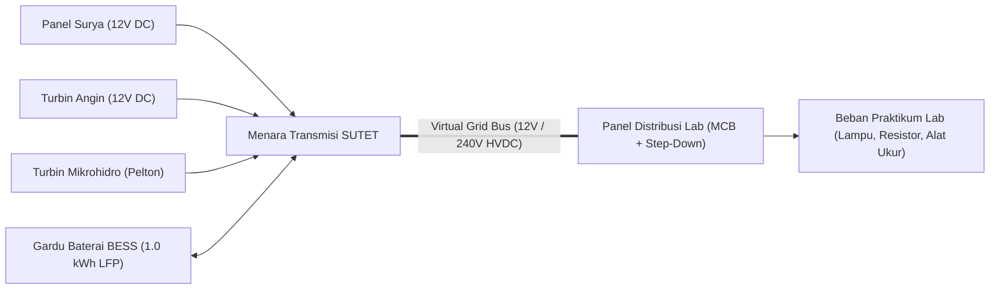

# Circuit Sandbox 4.0: Master Architecture Hub (MOC)

Welcome to the **Circuit Sandbox 4.0** Obsidian Engineering Vault. Press **`Ctrl + G`** (or **`Cmd + G`**) to open the **Force-Directed Knowledge Graph**.

The graph is organized into **7 color-coded engineering clusters**:
- **Cyan (`#hub`)**: Master Index & Session Devlogs
- **Emerald (`#physics-engine`)**: MNA Linear Solver, 2D Cellular Automata Terrain, Hydro & Microclimate Engines
- **Amber (`#outdoor-nature`)**: Nature Mode 4.0 Sandbox, Solar Ray-Casting, Orographic Wind, River Hydro
- **Sky Blue (`#hardware-node`)**: Generators, BESS Substation, SUTET Transmission, SNI/IEC Lab Hardware
- **Rose (`#protection-puil`)**: PUIL MCB Overcurrent Breakers, Schottky Blocking Diodes, Thermal Burnout
- **Teal (`#pedagogy`)**: Explainable Physics Tutor (KCL/KVL Proofs), Academy Curriculum, Troubleshooting Lab
- **Slate (`#ui-antislop`)**: Industrial Anti-Slop Design System & Mobile 60fps Viewport Architecture

---

## 1. Core Architecture & Session Devlogs (`#hub`)

- [[DEVLOG_SESSION_NATURE_MODE_4.0|Nature Mode 4.0 Engineering Devlog]]
- [[DEVLOG_ANTISLOP_MODAL_AND_ASSET_OVERHAUL|Anti-Slop 5-Screen Modal & Hardware Asset Overhaul Devlog]]
- [[ARCHITECTURE_OUTDOOR_AND_LAB_QUARANTINE|Dual-World Quarantine & Virtual Grid Bus Architecture]]
- [[CIRCUIT_SANDBOX_4.0_ARCHITECTURE.canvas|Visual System Architecture Canvas (.canvas)]]
- [[TESTING_AND_VERIFICATION_MATRIX|Deterministic Vitest Verification Matrix (314 Tests)]]

---

## 2. Physics & Numerical Simulation Engines (`#physics-engine`)

- [[PHYSICS_MNA_SOLVER_AND_TRANSMISSION_GRID|Modified Nodal Analysis (MNA) Solver & Virtual Grid Bus]]
- [[PHYSICS_TERRAIN_CELLULAR_AUTOMATA|2D Cellular Automata Terrain & Hydrological Spring Engine (40x20)]]
- [[PHYSICS_SOLAR_AND_OROGRAPHIC_WIND|1D Topographic Ray-Casting & Hellmann Orographic Wind Shear]]
- [[PHYSICS_MICROHYDRO_AND_BESS_STORAGE|Pelton Micro-Hydro Electromechanics & LFP BESS Storage (1.0 kWh)]]

---

## 3. Hardware Nodes & Protection Standards (`#hardware-node` / `#protection-puil`)

- [[HARDWARE_COMPONENTS_AND_PROTECTION|SNI/IEC Hardware Catalog, Schottky Diodes & PUIL MCB Protection]]
- [[HARDWARE_TRANSMISSION_AND_TRAFO_SUTET|Gardu Trafo Cantol SUTET (12V vs 240V Step-Up) & Joule Line Loss]]
- [[ASSET_PIPELINE_NANO_BANANA_AND_ALPHA_MATTING|Nano Banana 2.1 Asset Engineering & BFS Alpha-Matting Pipeline]]

---

## 4. Pedagogy, Diagnostics & UI Engineering (`#pedagogy` / `#ui-antislop`)

- [[PEDAGOGY_ACADEMY_AND_EXPLAINABLE_TUTOR|Explainable Circuit Physics Tutor, Academy & Troubleshooting Lab]]
- [[UI_UX_ANTISLOP_AND_MOBILE_ENGINE|Anti-Slop Industrial UI Design System & Mobile 60fps Engine]]

---

## 5. End-to-End Power Flow Topology

